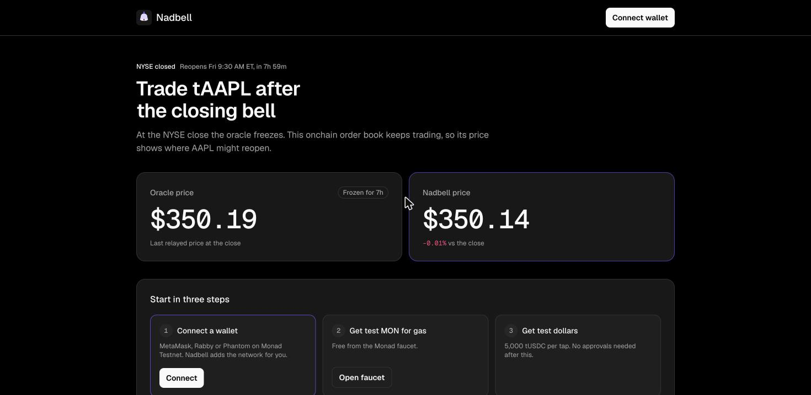

# Nadbell

**When NYSE closes, the price of a tokenized stock freezes until the next open. Nadbell keeps a market for it running in between.**

Every weekend the AAPL price is frozen for about 65 hours. Nadbell is a mock tokenized-stock (RWA) market on Monad testnet whose onchain order book trades 24/7. While NYSE is open it tracks the real price. After the bell its trades show where AAPL might reopen, and anyone can call the open for free and get scored against the real one.

**Live:** https://nadbell.vercel.app · **Contracts:** verified on [MonadVision](https://testnet.monadvision.com/address/0x8eb6048E7084eFd8a437FF1911f2F0f886904145?tab=Contract) · **CI:** `forge test` (26 tests incl. a fuzzed no-cross check) + app tests on every push



> Testnet demo only. tAAPL and tUSDC are mock tokens with no value. They are not issued by or affiliated with Apple, Nasdaq, Alpaca, Robinhood, Kraken, Dinari, Ondo or Anchored, and represent no ownership, claim or economic right in any security. Prices come from Alpaca's free IEX feed, relayed by a single keeper. Not investment advice and not an offer of securities. Do not deploy to mainnet.

## Evidence

Every claim here points to code, a test or a transaction.

| Claim | Proof |
|---|---|
| The order book is fully onchain and can never be left crossed | [`OrderBook.sol#L100`](contracts/src/OrderBook.sol#L100) (`placeIOC`), fill cap and refund at [`#L114-L128`](contracts/src/OrderBook.sol#L114-L128); [`testFuzz_EscrowAndNoCross`](contracts/test/Nadbell.t.sol#L423) |
| The market closes and reopens onchain | [`PriceGate.sol#L118`](contracts/src/PriceGate.sol#L118) `close()`; a real [close tx](https://testnet.monadvision.com/tx/0x0da399eb9b10a73e65341c3b0a773336812c2a6da6a651c768aa1fe1e3c4e718) and [price push](https://testnet.monadvision.com/tx/0xd85bf38515ca43ec255b39e5ca092089e485ab8ca1c58bf0fc78a3f3fc8cd2f6) |
| A bad price can't jump more than 15% in one push | [`PriceGate.sol#L149`](contracts/src/PriceGate.sol#L149); [`test_KeeperRoleAndMoveGuard`](contracts/test/Nadbell.t.sol#L366) |
| Calls are settled against the real open at the reopen | [`OpenCall.sol#L57`](contracts/src/OpenCall.sol#L57) `onReopen`; [`test_CloseFreezesAndReopenSettlesCalls`](contracts/test/Nadbell.t.sol#L298); a broken listener never blocks the reopen ([`test_BrokenListenerNeverBlocksReopen`](contracts/test/Nadbell.t.sol#L359)) |
| Minting stops when the price is stale; the book keeps trading | [`test_MintRejectedWhenPrintIsStale`](contracts/test/Nadbell.t.sol#L74), [`test_BookStillTradesWhenPrintIsStale`](contracts/test/Nadbell.t.sol#L85) |
| The app and the keeper agree on NYSE hours | [`nyse.test.ts`](app/src/lib/nyse.test.ts) compares both calendars every 30 minutes through 2026–27, incl. holidays and early closes |
| It runs | Since 17 Oct 2026 the [order book](https://testnet.monadvision.com/address/0x8eb6048E7084eFd8a437FF1911f2F0f886904145) has 679 txs and the [PriceGate](https://testnet.monadvision.com/address/0x644172e1C27D20513De62D2887F8631b05965C4B) 158 (counts on 20 Nov). Nearly all come from the keeper and its maker bot; user trades and calls are still few. |

## Trusted keys

One wallet ([`0xE87B…9842`](https://testnet.monadvision.com/address/0xE87BF5a41C3Cf6e535C7C5e8E83feB293bbF9842)) deployed everything and is both owner and keeper. What it can do:

| Power | Where | Why it exists |
|---|---|---|
| Push the price and close the market | [`PriceGate.sol#L108`](contracts/src/PriceGate.sol#L108), [`#L118`](contracts/src/PriceGate.sol#L118) | There's no free US-equity oracle on Monad testnet (see below). |
| Force a price past the 15% guard, change the guard and max age | [`#L113`](contracts/src/PriceGate.sol#L113), [`#L87`](contracts/src/PriceGate.sol#L87) | Recover after a real gap (earnings, splits). |
| Mark a spender as trusted, so it can move holders' tUSDC/tAAPL without `approve()` | [`MockUSDC.sol#L25`](contracts/src/MockUSDC.sol#L25), [`StockToken.sol#L58`](contracts/src/StockToken.sol#L58) | One-click trading on testnet. Only the vault and the book are trusted ([`Deploy.s.sol#L61-L63`](contracts/script/Deploy.s.sol#L61-L63)), but the owner could add another. That's acceptable only because the tokens are worthless mocks. |
| Pause tAAPL, block an address, set the dividend/split multiplier | [`StockToken.sol#L48-L58`](contracts/src/StockToken.sol#L48-L58), [`#L100`](contracts/src/StockToken.sol#L100) | Mirrors the controls a real stock-token issuer has. |

The order book itself has no admin functions. But through the trusted-spender switch the token owner could move any holder's mock tokens, the book's escrow included. With real-value tokens this design would be unacceptable; use plain `approve()` there.

## Why a blockchain

The weekend price is only worth something if nobody can quietly edit it. Every order, fill and call here is a public transaction, the scoring at the reopen happens in a contract nobody can change after the fact, and anyone can trade or build on the book without asking. A database run by us could fake all three.

## How it was built

- **13 Oct 2026:** UI prototype made with Grok's app builder.
- **13–17 Oct:** contracts, tests, keeper and the trading UI. The first commit (17 Oct) is a single import of 43,699 lines; about 40,500 of them are lockfiles, generated ABIs and the app builder's scaffolding. The project's own code was about 3,100 lines.
- **28 Oct:** the keeper wallet ran out of MON and the keeper failed. Fixed so the maker bot skips its quotes before the wallet runs dry.
- **19 Nov:** removed the app builder's leftover layer (auth, database, PWA plugin, 46 of 71 packages, a script from grok.com injected into every page), split the UI into one-job files, added CI and security headers, then a redesign around the oracle-vs-market gap.
- **20 Nov:** verified all six contracts on MonadVision ([`verify.yml`](.github/workflows/verify.yml)), added this evidence section, a 404 page and calendar tests.

## What a user does

1. **Connect** a wallet (MetaMask, Rabby, Phantom). Nadbell adds Monad testnet.
2. **Get test MON** for gas from https://faucet.monad.xyz, then **Get $5,000** test dollars in one tap.
3. **Buy $100 of tAAPL** or **Sell all**: one wallet confirmation, no approval pop-ups. Orders fill immediately at the best prices (never more than 1% past the top of the book) and anything unfilled comes straight back.
4. **When the market closes**, the banner says so and counts down to the reopen. Trading continues; a **Call the open** card lets anyone lock a free guess at Monday's opening price.
5. **At the reopen**, a **Last reopen** card shows the close, what this market said, and the real open, plus how close each call was and a leaderboard.

Limit orders, mint/redeem and an explainer live under **Advanced**.

## How it works

| Piece | What it does |
|---|---|
| `PriceGate` | Official price + market state. The keeper `push()`es during regular hours (the first push after a close reopens the market) and `close()`s after the bell. Rejects a push >15% from the last one (owner can `forcePush`). Can also take Pyth pull updates. |
| `OrderBook` | Fully onchain limit order book, tAAPL/tUSDC, trades 24/7. Best price first, then first come. `placeLimit` rests leftovers; `placeIOC` (the Buy/Sell buttons) refunds them. Max 20 fills per call; the book can never be left crossed. |
| `OpenCall` | "Call the open." Calls are free and allowed only while closed. On reopen, PriceGate notifies it and it records the close, the last weekend trade and the open. Scoring happens in views/frontend. |
| `Vault` | Mint/redeem at the official price ± 0.5%, only while the market is open (like an issuer). |
| `StockToken` (tAAPL) | ERC-20 with a display multiplier for dividends/splits (ERC-8056 draft, as used by Robinhood Stock Tokens). |
| `MockUSDC` (tUSDC) | Faucet dollar. |
| Trusted spenders | On testnet, tUSDC/tAAPL let Nadbell's own vault and book move funds without `approve()`, so every action is one confirmation. Never do this with real-value tokens. |
| Keeper + maker bot (`keeper/`) | Scheduled every 5 minutes on GitHub Actions (GitHub runs it far less often in practice, see Known limits). Uses Alpaca's market clock (falls back to a built-in NYSE calendar with 2026–27 holidays), pushes Alpaca's latest IEX trade while open, rings the bell after close. The maker keeps two buy and two sell quotes on the book: tight around the official price while open, wider around the last trade while closed so users move the weekend price. It only re-quotes when quotes drift >0.15% (open) / 0.30% (closed) or get filled. |

Why a keeper and not an oracle: as of October 2026 there is no free US-equity oracle on Monad testnet. Pyth Hermes needs a paid key since Aug 26, 2026 and moved extended hours to paid Pyth Pro; Chainlink ended its Data Streams free tier on Sept 1, 2026. The keeper is honest about it: the app names the source and shows how old the price is.

## Repo layout

```
contracts/          Foundry project (src, test, script)
keeper/             keeper + maker bot (Node, viem)
app/                web app (TanStack Start + React + viem); UI in src/components/desk/, chain reads in src/lib/chain/
.github/workflows/  keeper.yml: the keeper schedule · ci.yml: contract, app and keeper checks on every push · verify.yml: publishes contract source on MonadVision
docs/               screenshot used in this README
```

## Setup

### 1. Contracts

```bash
cd contracts
npm install                  # OpenZeppelin, Pyth SDK, forge-std
forge test                   # 26 tests, incl. a randomized escrow/no-cross check
```

Deploy to Monad testnet from a testnet-only wallet with some MON. Set `START_PRICE_CENTS` to roughly today's AAPL price so the first keeper push isn't rejected by the 15% guard:

```bash
START_PRICE_CENTS=22300 forge script script/Deploy.s.sol \
  --rpc-url monad_testnet --private-key $PRIVATE_KEY --broadcast
```

Addresses land in `contracts/deployments/10143.json`. Verify on MonadVision: https://docs.monad.xyz/guides/verify-smart-contract

### 2. Sync addresses into the app and keeper

```bash
cd app && npm install && npm run sync:contracts
```

### 3. Keeper

1. Make a free Alpaca account at https://alpaca.markets and create **paper trading** API keys (they work for the free IEX market data and the market clock).
2. Push this repo to GitHub. In **Settings → Secrets and variables → Actions**, add `KEEPER_PK` (the deployer key, or a separate keeper wallet set with `KEEPER_ADDRESS` at deploy), `ALPACA_KEY_ID` and `ALPACA_SECRET`.
3. The `keeper` workflow then runs every 5 minutes. Use **Run workflow** once to test it.

Try it locally first: `cd keeper && npm install && KEEPER_PK=… ALPACA_KEY_ID=… ALPACA_SECRET=… DRY_RUN=1 node keeper.mjs`.

Gas: most runs send 0–1 transactions (a price push). A full re-quote is up to ~9. Keep a few MON in the keeper wallet; it logs a warning below 1 MON. GitHub can delay scheduled runs, so a price stays "fresh" for 30 minutes (`MAX_AGE`).

### 4. App

```bash
cd app
npm run dev                  # http://localhost:8080, reads Monad testnet by default
```

Vercel deploys `main` automatically; `npm run build` writes Vercel output, including the security headers (CSP, HSTS, nosniff, frame-ancestors) from `vite.config.ts`. Run `npm run typecheck && npm run lint && npm test` before pushing; CI runs the same plus `forge test`. Local chain: run `anvil`, deploy with `--rpc-url http://127.0.0.1:8545`, sync, then `VITE_CHAIN_ID=31337 npm run dev`. `VITE_DEV_PK` signs with a local burner key; never set it on a public deploy.

The deployer wallet sees **Keeper controls** under Advanced (push a price, ring the bell) for testing without waiting for the schedule.

## Known limits

- GitHub delays and drops scheduled workflows on free runners. In Nov 2026 the 5-minute keeper actually ran about 3 times a day, so during NYSE hours the price is often stale. The app shows this with a Late badge and pauses minting.

- One stock, one book. Every order touches the same storage, so Monad's parallel execution doesn't speed this book up.
- The price comes from IEX, about 2.5% of US volume, relayed by one keeper. It's a showcase, not an oracle.
- The leaderboard covers the last 8 reopens and is computed in the browser. `OpenCall` caps a session at 1,000 callers.
- The built-in NYSE calendar covers 2026–27; Alpaca's clock is used when keys are set.
